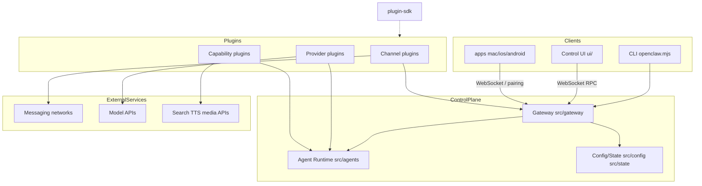
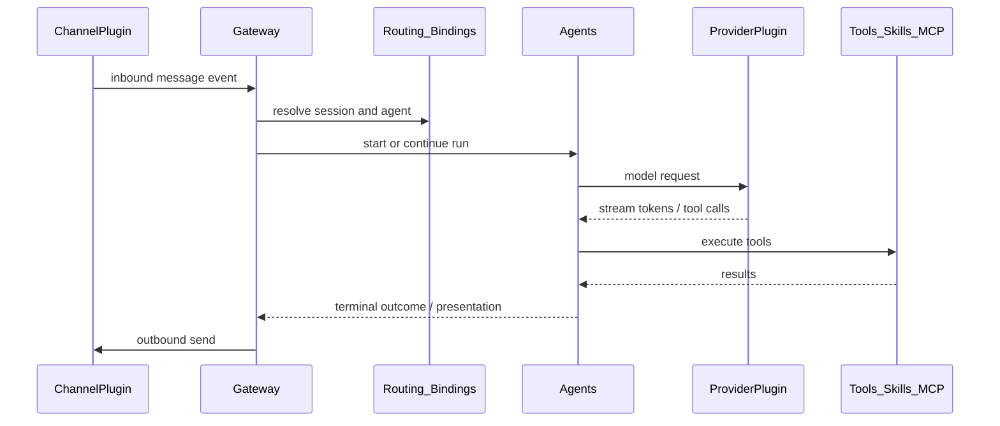

OpenClaw is a self-hosted **multi-channel AI assistant control plane**. The long-lived **Gateway** is the single source of truth for sessions, channels, tools, events, and config. Optional integrations ship as plugins under `extensions/`; clients (CLI, Control UI, native apps) connect over the Gateway WebSocket protocol.

For Gateway wire protocol and pairing details, see [Gateway architecture](/concepts/architecture). For agent loop internals, see [Agent runtime architecture](/agent-runtime-architecture). For plugin capability model depth, see [Plugin internals](/plugins/architecture).

## Design principles

- **Gateway as control plane**: one process owns messaging surfaces, operator RPC, and agent orchestration.
- **Plugin-agnostic core**: channels, model providers, and optional capabilities live in `extensions/`. Core provides the generic loop, protocol, loader, and `openclaw/plugin-sdk/*` contracts.
- **Local-first defaults**: canonical config is `openclaw.json`; runtime state prefers SQLite; remote exposure is explicit and hardened.
- **Doctor migrations, not runtime shims**: the runtime reads the current config shape only. Older shapes migrate through `openclaw doctor --fix`.



## Monorepo layout

Workspace members (see `pnpm-workspace.yaml`): the root package, `ui`, `packages/*`, `extensions/*`, and `examples/*`.

| Top-level path | Role | What it serves |
| -------------- | ---- | -------------- |
| `src/` | Core runtime: CLI, Gateway, agents, channel abstractions, plugin loader, plugin SDK implementation | Main server / CLI |
| `ui/` | Control UI (Lit + Vite) | Browser operator console |
| `apps/` | Native companions (macOS, iOS, Android, shared Kit) | Device nodes and desktop control |
| `packages/` | Shared libraries (protocol, agent-core, llm-core, gateway-client, …) | Reusable contracts and implementations |
| `extensions/` | Bundled plugins (~150): channels, providers, capabilities | Extension surface |
| `skills/` | Bundled agent skills (separate from code plugins) | Skill packs |
| `docs/` | Source docs published to docs.openclaw.ai | Documentation |
| `scripts/` | Build, test, release, Crabbox | Engineering tooling |
| `test/`, `qa/` | Cross-package tests and QA scenarios | Verification |
| `config/`, `deploy/`, `patches/` | Tooling config, deploy samples, dependency patches | Ops / engineering |
| `openclaw.mjs` | npm `bin` entry | CLI launcher |

## Feature modules and owning directories

This section maps product features to **top-level directories** (not function-level call graphs).

### Process entrypoints

| Feature | Entry / directory |
| ------- | ----------------- |
| CLI startup | `openclaw.mjs` → `src/entry.ts` → `src/cli/`, `src/commands/` |
| Library export | `src/index.ts` (`package.json` main → `dist/index.js`) |
| Gateway service | `src/gateway/` (`server.ts` / `server.impl.ts`, HTTP, WebSocket, RPC methods) |
| Daemon / install | `src/daemon/`, `src/process/`, root `Dockerfile` / `docker-compose.yml` |

### Control plane (Gateway)

| Feature | Code modules |
| ------- | ------------ |
| WebSocket / HTTP, auth, pairing | `src/gateway/` |
| RPC registration and lazy handlers | `src/gateway/server-methods.ts`, `src/gateway/server-methods/`, `src/gateway/methods/` |
| Protocol schemas and validators | `packages/gateway-protocol/` |
| Browser / node clients | `packages/gateway-client/`, `ui/src/api/gateway.ts` |
| Public SDK | `packages/sdk/` |

### Agent runtime

| Feature | Code modules |
| ------- | ------------ |
| Agent loop, sessions, tool orchestration | `src/agents/` |
| Reusable agent core | `packages/agent-core/` |
| LLM contracts / streaming adapters | `packages/llm-core/`, `packages/ai/`, `src/llm/`, `src/provider-runtime/` |
| Model catalog | `packages/model-catalog-core/`, `src/model-catalog/` |
| Auto-reply / chat pipeline | `src/auto-reply/`, `src/chat/` |
| Terminal UI | `src/tui/`, `packages/terminal-core/` |
| ACP | `src/acp/`, `packages/acp-core/` |

### Messaging channels

| Feature | Code modules |
| ------- | ------------ |
| Channel abstractions and message contracts | `src/channels/` |
| Routing / bindings | `src/routing/`, `src/bindings/` |
| Outbound infrastructure | `src/infra/outbound/` |
| Concrete channels (Telegram, Discord, Slack, …) | `extensions/<channel-id>/` via plugin SDK only |

Channel plugins stay transport-oriented. Product command trees and policy are declared by core or owner plugins; channels map portable presentation and native envelopes.

### Plugin system

| Feature | Code modules |
| ------- | ------------ |
| Discovery, activation, registry | `src/plugins/` |
| Plugin SDK (only supported cross-boundary API) | `src/plugin-sdk/` + `packages/plugin-sdk/` |
| Package contract / manifest | `packages/plugin-package-contract/`, each plugin `openclaw.plugin.json` |
| Optional integrations | `extensions/` |

### Config, state, secrets

| Feature | Code modules |
| ------- | ------------ |
| Config load / schema / doctor entrypoints | `src/config/`, `src/commands/` |
| Runtime state (SQLite-first) | `src/state/`, `src/sessions/` |
| Secrets / SecretRef | `src/secrets/` |
| Onboard / wizard | `src/bootstrap/`, `src/wizard/` |

### Tools, skills, MCP, memory

| Feature | Code modules |
| ------- | ------------ |
| Built-in / generic tools | `src/tools/`, `src/agents/tools/` |
| Skills runtime and bundled packs | `src/skills/`, `skills/` |
| MCP | `src/mcp/` |
| Memory host | `packages/memory-host-sdk/`, `src/memory*`, plugins such as `extensions/memory-lancedb` |
| Context engine | `src/context-engine/` |

### Media and generation

| Feature | Code modules |
| ------- | ------------ |
| Media codecs / policy | `packages/media-core/`, `src/media*` |
| Image / video / music generation | `packages/media-generation-core/`, `src/image-generation` and related paths + matching extensions |
| Speech | `packages/speech-core/`, `src/tts/`, `src/talk/` |
| Web content | `packages/web-content-core/` |

### Scheduling, tasks, hooks, audit

| Feature | Code modules |
| ------- | ------------ |
| Cron | `src/cron/` |
| Background tasks | `src/tasks/` |
| Hooks / flows | `src/hooks/`, `src/flows/` |
| Audit / status / security | `src/audit/`, `src/status/`, `src/security/` |
| Node host / pairing | `src/node-host/`, `src/pairing/` |

### Control UI

| Feature | Code modules |
| ------- | ------------ |
| Vite entry | `ui/index.html` → `ui/src/main.ts` → `ui/src/app/` |
| Routes / pages | `ui/src/pages/`, `ui/src/app-routes.ts` |
| Gateway connection | `ui/src/api/gateway.ts`, `ui/src/app/gateway-store.ts` |
| Build output | `dist/control-ui` (served by Gateway or via `pnpm ui:dev`) |

### Native apps

| App | Directory |
| --- | --------- |
| macOS menu bar / Gateway control | `apps/macos/` |
| iOS / Android nodes | `apps/ios/`, `apps/android/` |
| Shared Apple kit | `apps/shared/` |
| Local TTS / wake word | `apps/macos-mlx-tts/`, `apps/swabble/` |

## Entrypoints and integration

### Backend (core + Gateway)

```text
openclaw.mjs
  → src/entry.ts
  → src/cli / src/commands
  → src/gateway/*          # HTTP + WebSocket + RPC
  → src/agents/*           # agent runs under Gateway orchestration
  → src/plugins/*          # loads extensions
```

Clients call typed RPC methods such as `config.get`, `chat.send`, and `models.list`. Schemas live in `packages/gateway-protocol`; handlers live under `src/gateway/server-methods*`. The common local Gateway bind is `127.0.0.1:18789` (Control UI may use Vite on `5173` during development).

### Frontend (Control UI)

```text
ui/vite → ui/src/main.ts → app-host
  → GatewayBrowserClient (ui/src/api/gateway.ts)
  → packages/gateway-protocol frame types
  → WebSocket RPC → Gateway
```

Control UI is a Gateway protocol client. Operator actions go through WebSocket RPC, not a separate business REST API.

### Native clients

Native apps pair as **nodes** over the same Gateway WebSocket. App code lives in `apps/*`; pairing and capability policy are enforced on the Gateway side.

### Plugin contract (external service seam)

```text
extensions/<id>/
  openclaw.plugin.json
  package.json
  api.ts / runtime-api.ts
  → depends only on openclaw/plugin-sdk/*
```

Core discovers and activates plugins through `src/plugins/`. Plugin production code must not import `src/**` or another plugin's `src/**`.

### External services by plugin family

| Kind | Where it integrates | Examples |
| ---- | ------------------- | -------- |
| Messaging | `extensions/<channel>` | Telegram, Discord, Slack, WhatsApp, Signal, Matrix, Feishu |
| Model APIs | `extensions/<provider>` | OpenAI, Anthropic, Google, DeepSeek, Qwen, Ollama, Bedrock |
| Search / crawl | capability extensions | Brave, Tavily, Firecrawl, Exa |
| Speech / media cloud | speech and media extensions | ElevenLabs, Deepgram, Fal, Comfy |
| Observability | diagnostics extensions | OpenTelemetry, Prometheus |
| Hosting samples | repo root | Docker, Fly, Render |

## Module dependency relationships

### Runtime path (message in, reply out)



### Layer rules

| Layer | May depend on | Must not depend on |
| ----- | ------------- | ------------------ |
| `ui/` / `apps/` | Gateway protocol + WebSocket | `extensions/*/src`, agent internals |
| `src/gateway` | agents, plugins, config, protocol | Concrete Telegram/Discord implementation details |
| `src/agents` | llm / provider-runtime, tools, plugin-sdk-injected capabilities | Channel SDK private APIs |
| `extensions/*` | `openclaw/plugin-sdk/*` only | `src/**`, other plugins' internals |
| `packages/*` | Stable libraries consumed by core/UI | Channel business logic |

### Shared packages by concern

- **Protocol**: `gateway-protocol` → Gateway methods and client validation
- **Intelligence**: `agent-core`, `llm-core`, `ai` → agent and provider adapters
- **Content**: `markdown-core`, `media-*`, `web-content-core`, `speech-core`
- **Policy**: `net-policy`, `normalization-core`, `tool-call-repair`

## Extension families (sample)

`extensions/` holds on the order of **150** plugin directories. Grouped by `openclaw.plugin.json` capability:

- **Channels**: `telegram`, `discord`, `slack`, `whatsapp`, `signal`, `matrix`, `feishu`, `irc`, `line`, `imessage`, …
- **Providers**: `openai`, `anthropic`, `google`, `deepseek`, `qwen`, `ollama`, `amazon-bedrock`, `openrouter`, `codex`, …
- **Capabilities**: `browser`, `memory-lancedb`, `voice-call`, `webhooks`, `firecrawl`, `diagnostics-otel`, `canvas`, `workboard`, …

## Architecture patterns

1. **Hub-and-spoke**: Gateway at the center; CLI, UI, native apps, and channel plugins as spokes.
2. **Plugin-oriented core**: core owns the generic loop and SDK; optional integrations stay in extensions.
3. **Protocol-first UI**: Control UI is a browser client of the Gateway protocol.
4. **Canonical config + doctor migration**: upgrades rewrite config through doctor, not dual-read runtime paths.
5. **SQLite for runtime state**: app state and caches belong in SQLite; files are for product artifacts (import/export, attachments, logs).

## Suggested reading order

1. [VISION](https://github.com/openclaw/openclaw/blob/main/VISION.md) and README architecture links
2. `src/entry.ts` → `src/gateway/` → `src/agents/`
3. `src/plugins/` + `src/plugin-sdk/` + sample manifests in `extensions/telegram` and `extensions/openai`
4. `ui/src/main.ts` + `ui/src/api/gateway.ts`
5. Schema names in `packages/gateway-protocol/` (method surface inventory)

## Related

- [Gateway architecture](/concepts/architecture)
- [Agent](/concepts/agent)
- [Agent runtime architecture](/agent-runtime-architecture)
- [Plugins](/tools/plugin)
- [Plugin internals](/plugins/architecture)
- [Gateway protocol](/gateway/protocol)
- [RPC reference](/reference/rpc)
